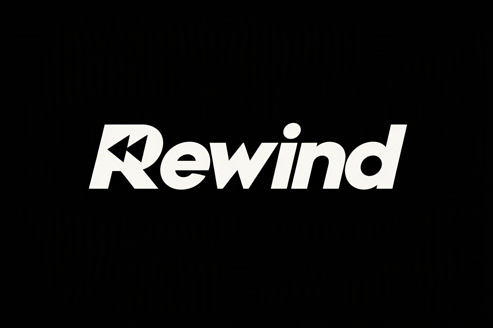

<p align="center">
  
</p>

<p align="center">
  <b>Step back inside your old videos and live events.</b><br>
  Built at HackPrinceton 2026, Entertainment track.
</p>

Rewind turns a recorded memory into a place you can stand inside. Put your phone in a Google Cardboard and you are where the video was filmed, watching the original video exactly as it was shot. AI builds the surroundings around it, so you can look around. The room is generated; the moment is real.

It has two modes:

- **Party mode.** One old video. World Labs Marble builds a 3D room from it, and the original video is projected back onto the room from the original camera's spot, with faded edges. You stand where the camera stood and look around.
- **Concert mode.** Several fans' clips of the same moment. The venue is rebuilt as a splat, each clip is pinned to the spot where it was filmed, the clips are synced by audio, and you jump between those seats while the music keeps going.

What it does not do: there is no walking around (you only turn your head), and the people stay flat inside the video. Anything the camera never saw is a best guess by the AI, so we call it recreated, not recorded.

## Contents

- [Status](#status)
- [How it works](#how-it-works)
- [Repository map](#repository-map)
- [Setup](#setup)
- [Party mode: make the world](#party-mode-make-the-world)
- [Party mode: view it](#party-mode-view-it)
- [Test on a phone](#test-on-a-phone)
- [Projection](#projection)
- [Concert mode](#concert-mode)
- [Find more angles](#find-more-angles)
- [Tests](#tests)
- [Known limits](#known-limits)
- [Docs, tickets and team notes](#docs-tickets-and-team-notes)
- [Team](#team)

## Status

Checked when this README was written (Nov 15, 2026):

- `node --test test/*.test.mjs`: 27 of 27 pass.
- `npm run build`: passes.

Results reported by the team (not covered by the automated tests):

- A real Marble room was generated from the party video.
- All five Athens fan clips registered together in COLMAP, and their audio offsets were computed (KAN-12) and checked by ear. Two clips match to about 0.02 s, the other two to about 0.15 s.

Not confirmed in this repo: the last on-phone checks recorded in `docs/updates.md` (Nov 14, Android, Chrome) used the dummy scene and test data. Check the real room and the real venue on the demo phone before you rely on them. See [Known limits](#known-limits).

## How it works

### Party mode

1. Pick the original video (mp4, webm, mov or avi, up to 100 MB). It stays as it is.
2. `npm run marble` sends it to World Labs Marble, waits for the world, and saves the splats, the collider mesh, a panorama and the video into `public/world/`. Marble can also build a room from a text prompt and up to four pictures, which is what the upload page does.
3. If the camera in the video pans, `npm run track` records where it was pointing in every frame, so the projector can turn with it.
4. The viewer (`index.html`, `src/main.js`) loads the room as a splat with Spark inside three.js. `collider.glb` is the hidden surface the video lands on.
5. `src/projection.js` plays the original video back onto the collider from the original camera's spot, like a slide projector. Where the video does not reach, the splat shows through, and the frame's edges fade out.
6. The viewer stands at the camera's spot. Android Chrome uses WebXR (Enter VR). iPhone Safari has no WebXR VR, so it uses side-by-side stereo with the gyro.

Optional extras, each switched on with a URL option or a file next to the world (see [Party mode: view it](#party-mode-view-it)):

- **Depth mesh** (`?depth=1`): the video becomes real geometry at the depths a depth model measured, so each Cardboard eye sees a slightly different view.
- **Tracked people**: people followed through the video (`npm run track-people`) become cut-out cards standing in the room instead of a flat overlay.
- **Paint mode** (`?paint=1`): the room's own splats take their colour from the video, with no separate layer.
- **Framing panel**: on-screen sliders for placing the video in the room, with a link you can copy to a phone.

### Concert mode

1. Several steady phone clips of the same moment, filmed from different spots, become the seats. The spot where each clip was filmed is where its seat sits.
2. Frames are pulled from the clips (`npm run extract-frames`). COLMAP and nerfstudio splatfacto (gsplat) rebuild the venue and recover each camera's position on a GPU machine.
3. `npm run export-cameras` turns the training run into `cameras.json`: one seat per clip with position, rotation, field of view and image size.
4. `scripts/sync_clips.py` lines the clips up by audio and gives each one an `offsetSeconds`. `scripts/merge-offsets.mjs` copies those into `cameras.json`.
5. The viewer (`concert.html`, `src/concert.js`) puts you at one seat. That seat's clip is projected onto the stage from its own spot. Only the current seat's clip shows, so moving people do not appear twice.
6. Every other seat has a marker. Look at one and tap (or hold your gaze, see [options](#viewer-options)) and the view jumps there. A short zoom-out, jump and zoom-in hides the cut (`src/seatTransition.js`).
7. All clips play from one master clock: `clipTime = masterTime - offsetSeconds` (`src/masterClock.js`). Only the current seat's clip has sound, and the old seat keeps playing until the new one is really playing, so the music does not skip.
8. At the start, only the video rectangle shows. After the first tap following Start, the venue builds outward from the video frame in cubes (`src/cubeReveal.js`). Add `?reveal=0` to skip this.

```
clips ──► extract-frames ──► COLMAP + splatfacto ──► export-cameras ──► cameras.json ─┐
  │                                                                                   ├──► concert.html
  └────► sync_clips.py ──► offsets.json ──► merge-offsets ────────────────────────────┘
```

Concert mode is a second page in the same app, not a separate viewer. It reuses `src/projection.js`.

## Repository map

```
index.html, src/main.js          party mode viewer: three.js + Spark, WebXR button, Cardboard fallback
concert.html, src/concert.js     concert mode viewer: seats, gaze or tap jump, master clock
upload.html, src/upload.js       upload page: build a room from a video, pictures and a prompt
angles.html, src/angles.js       "Find more angles" page (Grok + X search)
src/config.js                    viewer settings, all overridable from the URL
src/lookControls.js              gyro look (iPhone and Cardboard fallback) and drag-to-look on desktop
src/projection.js                addProjection(): projects the video onto the room
src/rotationTrack.js             camera rotation per frame for a video that pans (rotation.json)
src/depthMesh.js                 the video as real geometry from a depth video (?depth=1)
src/trackedPeople.js             tracked people as cut-out cards in the room
src/cutout.js                    one cut-out person card (stacked-alpha video)
src/splatPaint.js                colour the room's splats from the video (paint mode)
src/framingPanel.js              on-screen sliders for placing the video (Framing button)
src/uploadBackdrop.js            slow drifting view of the room behind the upload page
src/seats.js                     reads cameras.json into seats (accepted shapes are in the header comment)
src/masterClock.js               one clock for every concert clip
src/videoClip.js                 one concert clip: sync to the clock, mute, pause, seek
src/seatTransition.js            zoom, jump and zoom back between seats
src/cubeReveal.js                the venue appears cube by cube from the video frame
scripts/marble.mjs               build a Marble room from a video, a prompt or pictures, and download it
scripts/upload-server.mjs        local server behind the upload and angles pages (keeps API keys off the browser)
scripts/track-rotation.py        camera rotation tracker for a panning video (npm run track)
scripts/track-people.py          follow people through the video and measure their distance (npm run track-people)
scripts/depth-video.py           depth for every frame of a video (Video Depth Anything)
scripts/stabilize.py             warp frames back to the first frame's view using rotation.json
scripts/extract-frames.mjs       concert clips to frames for COLMAP, with clip names and timestamps
scripts/export-cameras.mjs       splatfacto run to cameras.json
scripts/sync_clips.py            audio sync of concert clips to offsets.json
scripts/merge-offsets.mjs        copies offsets.json into cameras.json, with checks
test/                            automated tests, plus dev-only test pages (see Tests)
docs/                            progress log, demo storyboard (PDF and HTML)
public/brand/                    Rewind logo and logo animation
public/world/                    your Marble run (not committed)
public/baby/, baby-room/, baby2/ demo worlds that are committed (see Demo worlds)
public/uploads/                  one folder per upload-page run (not committed)
public/concert/                  real concert assets (not committed)
public/concert-test/             table test data; only cameras.json is committed
CLAUDE.md                        background notes for AI coding assistants
```

Tech: three.js, Spark (Gaussian splats), Vite, World Labs Marble, COLMAP, nerfstudio (splatfacto, gsplat), WebXR, ffmpeg, Python (OpenCV, NumPy, SciPy), Video Depth Anything for depth, VitTrack for person tracking, and Node.

## Setup

Needs Node 22 or newer (tested on 22.23). The npm scripts use `node --env-file-if-exists`, which older versions do not have.

```bash
git clone https://github.com/SriSrik123/HackPrinceton.git
cd HackPrinceton
npm install
npm run dev
```

`npm run dev` serves HTTPS with a self-signed certificate. Phones need HTTPS for WebXR and the gyro. The pages are:

| Page | What |
| --- | --- |
| `https://localhost:5173/` | Party mode viewer |
| `https://localhost:5173/concert.html` | Concert mode viewer |
| `https://localhost:5173/upload.html` | Upload page (needs `npm run upload-server`) |
| `https://localhost:5173/angles.html` | Find more angles (needs `npm run upload-server`) |
| `https://localhost:5173/test/projection.html` | Projection test bench (dev only) |
| `https://localhost:5173/test/concert.html` | Venue and camera pose test (dev only) |

Other commands: `npm run build` (production build), `npm run preview`.

API keys go in `.env` (copy `.env.example`) or in your shell. Never commit `.env`.

| Variable | Used for |
| --- | --- |
| `WLT_API_KEY` | World Labs Marble (`npm run marble`, upload page). Costs credits. |
| `XAI_API_KEY` | Find more angles page. Not in `.env.example`, add it yourself. |
| `UPLOAD_PIN` | Optional. The upload and angles pages must send it before a run starts. |
| `UPLOAD_PORT` | Optional. Upload server port, default 8787. |

Other tools you may need:

- **ffmpeg** on your PATH for frame extraction, audio sync and the upload page.
- **Python 3 with `numpy` and `scipy`** for `scripts/sync_clips.py`.
- **A Python environment for camera tracking** (only for videos that pan): `python3 -m venv .venv && .venv/bin/pip install opencv-python-headless numpy`. `npm run track` and `npm run track-people` use `.venv/bin/python`, a macOS and Linux path. On Windows, run the scripts with your own Python. Person tracking needs OpenCV 4.9 or newer and downloads the VitTrack model into `.models/` the first time.
- **Depth** (optional): `scripts/depth-video.py` runs Video Depth Anything on Apple silicon (Metal) or CPU. The one-time setup commands are in the script's header and install into `.depth/`. The upload page skips depth if `.depth/` is not set up.
- **COLMAP and CUDA-enabled nerfstudio** for building a concert venue. These run on an NVIDIA GPU machine, preferably Linux or WSL2. See the Confluence concert guide linked below.

`npm install` fails inside a folder that does not allow symlinks (some synced or network drives). Copy the folder somewhere local first.

## Party mode: make the world

Costs Marble credits. Get an API key from the World Labs platform, then:

```bash
export WLT_API_KEY=your_key_here
npm run marble -- ~/Videos/party.mp4 --name "Party 2016"
```

It uploads the video, starts generation (`marble-1.1` by default, `--model marble-1.1-plus` or `--model marble-1.0-draft` to change), polls every 10 s (about 5 minutes), then saves into `public/world/`:

- `splat-500k.spz` and `splat-100k.spz`
- `collider.glb` (the surfaces the projection uses)
- `world.json` (world id, scale metadata, caption, video filename)
- `source.mp4` (a copy of your video, for the projection)

If it stops while waiting, it prints the resume command: `npm run marble -- --op <operation_id>`. To download a finished world again: `npm run marble -- --world <world_id> ~/Videos/party.mp4`.

Video rules from the Marble docs: mp4, webm, mov or avi, max 100 MB. To shrink a long or 4K clip:

```bash
ffmpeg -i party.mov -vf scale=-2:720 -c:v libx264 -crf 26 -c:a aac -b:a 128k party_720.mp4
```

Other options for `npm run marble`:

- `--prompt "an empty dining room ..."` builds a look-alike room from a description, and `--images a.jpg,b.png` uses up to four pictures as the room's look. You can combine them. Add `--video clip.mp4` for the video the viewer plays (it is copied in and never sent to Marble).
- `--out public/<folder>` saves somewhere other than `public/world/`.
- `--full 1` also saves the full-resolution splat as `splat-full.spz` (large). Open it with `?splat=full`.

A video world cost about $1.28 on `marble-1.1` when we read the pricing on Nov 13. Check the current price before spending.

### If the video pans: track the camera

Run this after every Marble run, and again whenever the video changes:

```bash
python3 -m venv .venv && .venv/bin/pip install opencv-python-headless numpy   # once
npm run track -- public/world/source.mp4
```

It writes `public/world/rotation.json`: where the camera was pointing in every frame (yaw, pitch, zoom), and where the first frame sits in Marble's room (fitted to `pano.png`, which the Marble script downloads). The viewer loads it by itself and turns the projector with the camera, so the video lands on the part of the room that was being filmed. `?track=0` turns that off for comparison. By default the video is also anchored: every frame is pinned back to where the first frame sits in the room, stretching the picture if needed, so the people at the table stay on Marble's copies of them. `?anchor=0` uses the camera's clean rotation instead. `.venv/bin/python scripts/track-rotation.py --selftest` checks the math on generated frames.

It only handles a camera that turns in one place. Marble redraws the room from the video, people included, so the video will not line up exactly: expect it to be close in the opening view and to drift by 10 to 25 degrees elsewhere. A video that turns through most of the room (Marble asks for 180 to 360 degrees) gives a much closer room than one that only covers part of it.

`scripts/stabilize.py` can also warp the frames back into the first frame's view using `rotation.json`, so the room holds still.

### People and depth (optional)

- **Depth:** `.depth/venv/bin/python scripts/depth-video.py public/world/source.mp4 --metric` writes `depth-metric.mp4` and `depth-metric.json` next to the video. Add `"depth": { "video": "depth-metric.mp4", "json": "depth-metric.json" }` to the world's `world.json` (the upload page does this for you). `?depth=1` then draws the video as real geometry at those depths, and `?depthScale=1.2` stretches the distances (the depth model's meters are not exactly Marble's).
- **People:** `npm run track-people -- public/world/source.mp4 --box 85,90,160,215` follows each boxed person (x,y,w,h in pixels on the first frame, one `--box` per person) with VitTrack and writes `tracks.json`. The viewer then shows each person as a cut-out card in the room. `?people=0` goes back to the flat overlay. With a depth video, the wall behind each person is cut out too.
- **Cut-out card:** if `world.json` has a `cutout` entry, a stacked-alpha video (color on top, mask below) is drawn as a card standing on the floor and facing the viewer. It plays on iPhone Safari too.

### Or from the upload page

One box: an mp4, up to 4 pictures and a prompt, then Create.

```bash
export WLT_API_KEY=your_key_here
npm run upload-server        # keeps the key on this computer, listens on 127.0.0.1:8787
npm run dev                  # in a second terminal, then open https://localhost:5173/upload.html
```

The server turns the mp4 into a 480p copy, asks Marble for a room from the prompt and pictures (the video itself is never sent, so its people and cake are not copied in), then adds depth with `scripts/depth-video.py` if `.depth/` is set up. Each run spends about $1.28 of Marble credits and takes around 6 minutes. The result goes to a new folder `public/uploads/<id>/`, never over `public/world/`, and the page ends with an Open button for `/?world=uploads/<id>`. Add `&depth=1` for the depth version. Set `UPLOAD_PIN=1234` on the server to require a PIN for uploads and angles searches; without it, anyone who can reach the dev server page can start a run. The page shows a slow, blurred view of the generated room behind the form. Concert mode on the page shows a "prepared example" card only; nothing uploaded is processed for concert mode.

## Party mode: view it

```bash
npm run dev
```

Desktop: open the `https://localhost:5173` link, accept the certificate warning, drag to look around.

URL options (no rebuild needed). Defaults live in `src/config.js`.

| Option | Default | What it does |
| --- | --- | --- |
| `?world=baby2` | `world` | Which folder under `public/` to load (`world.json`, splats, collider, video) |
| `?splat=100k` | `500k` | Splat size: `500k`, `100k`, or `full` if you saved it. Use `100k` if the phone stutters |
| `?flip=0` | 1 | Turn off the 180° X flip Marble splats need. Try it if the room is upside down |
| `?colliderFlip=1` | 0 | Extra flip for the collider only |
| `?metricScale=0` | 1 | Ignore Marble's scale metadata (by default 1 unit is 1 meter and the floor is y = 0) |
| `?cam=0,1.5,0` | the raw Marble origin | Where the viewer's head sits, in meters |
| `?yaw=90` | 0 | Which way the viewer faces at the start, in degrees |
| `?start=x,z` | from `world.json` | Where the viewer starts, meters from the Marble origin (+x right, -z ahead) |
| `?eyeSep=0.06` | 0.064 | Eye separation for the Cardboard fallback, meters |
| `?track=0` | on | Ignore `rotation.json` and pin the video to its first-frame spot |
| `?anchor=0` | on | With a track: use the camera's clean rotation instead of pinning to the first frame |
| `?paint=1` | off | Paint the room's splats from the video (or set `"paint": true` in `world.json`) |
| `?depth=1`, `?depthScale=1.2` | off, 1 | Depth mesh, and how far to stretch its distances |
| `?people=0` | on | Go back to the flat overlay instead of tracked-person cards |
| `?cutout=x,z`, `?cutoutH=` | from `world.json` | Position (meters, -z ahead) and height of the cut-out card |
| `?cut=x,y,z,w,h,d;...` | none | Hide parts of the splat with boxes (center then size, viewer meters, y = 0 is the floor) |
| `?debug=1` | off | Collider wireframe, axes and the projector frustum |

Tap the **Framing** button (desktop and phone, hidden in Cardboard mode) for sliders that place the video in the room: turn, tilt, roll, size, edge blur, opacity, brightness and more. Settings are remembered per world in this browser, and **Copy link** gives a URL with the same values to open on a phone or share.

### Demo worlds

Folders under `public/` that you can open with `?world=`:

| `?world=` | What |
| --- | --- |
| `world` (default) | Your own Marble run from `npm run marble` (not committed) |
| `baby` | "Baby lift": a warmly lit room built from a home video |
| `baby-room` | An empty living room with a cut-out person card |
| `baby2` | A classic movie theater with a home video playing on the screen |
| `uploads/<id>` | A run from the upload page (not committed) |

First run with a new world: open with `?debug=1`. You get the collider as a green wireframe and an axes helper. Check that:

1. The room is right side up. If not, try `?flip=0`.
2. The wireframe lines up with the splat. If it is upside down relative to it, try `?colliderFlip=1`.
3. You are standing where the camera was. If not, set `?cam=x,y,z` and `?yaw=`. World Labs does not document that the raw origin is the original camera, so this is an assumption to check.

## Test on a phone

WebXR and the gyro only work over HTTPS, which is why the dev server uses a self-signed certificate.

**Same Wi-Fi:** run `npm run dev`, find the computer's IP (on a Mac, `ipconfig getifaddr en0`), open `https://<that-ip>:5173` on the phone and tap through the certificate warning (Advanced, then Proceed or Visit website).

**If the phone can't reach the computer** (campus and event Wi-Fi often blocks device-to-device traffic): use a tunnel.

```bash
brew install cloudflared
cloudflared tunnel --url https://localhost:5173 --no-tls-verify
```

Open the `https://….trycloudflare.com` link it prints on the phone. That one has a real certificate, so there is no warning. A phone hotspot with the computer joined to it is the other option.

**Android (Chrome):** tap **Enter VR**, put the phone in the Cardboard. If the button says VR is not supported, use **Cardboard (gyro)** instead.

**iPhone (Safari):** WebXR VR is not available, so tap **Cardboard (gyro)** and tap **Allow** on the motion prompt. The phone goes side by side; tap the screen to recenter. To get out, tap **Exit** in the corner.

If it stutters, add `?splat=100k`. Keep splats small for phones: 500k SPZ by default, 100k if needed, and the concert venue shrunk and converted to SPZ.

## Projection

`src/projection.js` plays the original video back onto the room from the original camera's spot, like a slide projector. Each point of `collider.glb` looks up where it falls in the projector's view: inside the frame it shows that video pixel, outside it the splat shows through, and the frame's edges fade out. `main.js` calls `addProjection(scene, video, surfaces, opts)` once and `update(dt)` every frame. The file never starts the video itself. With a rotation track, the projector is aimed every frame from the camera's recorded rotation and zoom.

It also covers the cases where something is missing:

- No `collider.glb`: it projects onto a stand-in box room (floor, ceiling, three walls) built around the projector. Good enough to see the video, but it will not match the real room.
- No `"video"` in `world.json`: it shows a test pattern (grid, red crosshair, TOP / BOTTOM / LEFT / RIGHT) so you can still line things up.
- The collider meshes stay invisible. With `?debug=1` you also get their wireframe, the projector's frustum, and `projection` in the browser console.

URL options (no rebuild needed). Every param in `DEFAULTS` at the top of `src/projection.js` has one: `proj` plus the param name.

| Option | Default | What it does |
| --- | --- | --- |
| `?projPos=x,y,z` | the rig (camera spot) | Projector position, meters, world space |
| `?projYaw=` | the rig's yaw (`?yaw=`) | Degrees. Plus turns left |
| `?projPitch=` | 0 | Degrees. Plus looks up |
| `?projRoll=` | 0 | Degrees. Plus tilts counter-clockwise |
| `?projFov=` | 50 | Vertical field of view, degrees. Landscape phone video is about 40 to 50, portrait about 65 |
| `?projFade=` | 0.12 | Soft edge width, as a fraction of the frame. 0 is a hard edge |
| `?projOpacity=` | 1 | 0 to 1 |
| `?projBrightness=`, `?projSaturation=`, `?projTint=ffcc88` | 1, 1, ffffff | Color match the video to the splat |
| `?projShading=`, `?projAmbient=` | 0.6, 0.35 | How much surfaces facing away from the projector darken, and the darkest they get |
| `?projEnabled=0` | 1 | Hide the projection |
| `?projRoomSize=w,h,d`, `?projRoomEye=`, `?projRoomBehind=` | 4,2.6,5 / 1.4 / 0.1 | Stand-in room size, projector height above its floor, floor behind the projector (meters) |

How to line it up:

1. Open with `?debug=1` and do the three checks above first (room upright, wireframe on the splat, standing at the camera's spot). The projector starts at the same spot and yaw as the viewer.
2. Set `?projFov=` first. Too small and the video's walls look narrower than the room's, too big and they look wider. The value is a guess until tuned: the real camera's field of view is not known.
3. Then `?projYaw=`, `?projPitch=` and `?projRoll=` until the video's corners and edges sit on the room's.
4. Only touch `?projPos=` if nearby objects are still off after that.
5. Match colors with `?projBrightness=`, `?projSaturation=` and `?projTint=`, and widen `?projFade=` until the frame's border disappears.

To tune live, use the console in debug mode, for example `projection.update({ fov: 44, yaw: 3 })`, then copy the values that work into the URL. `projection.params` shows the current values.

For sliders, run `npm run dev` and open `https://localhost:5173/test/projection.html`. It is a fake room where you can add several videos or photos, look through each projector, and copy the poses as JSON. It is not part of `npm run build`.

For concert mode: call `addProjection(scene, clipVideo, stageGlb, { pos, yaw, pitch, roll, fov })` once per seat and show one at a time with `update({ enabled: false })`. Several projections can share the same meshes. Values passed in code win over the URL.

Occlusion is not handled. Seen from the projector's own spot this is invisible, because every surface along a ray shows the same video pixel. From anywhere else, a surface hidden behind furniture still gets a copy of the video, and the furniture does not hide the projection behind it. So keep the viewer at the projector: if you move the projector with `?projPos=`, set `?cam=` to the same place. The console warns when they are more than 5 cm apart.

## Concert mode

Open `https://localhost:5173/concert.html`. With no data it shows a dummy scene: three seats, a flat stage panel, and fake clips that draw their own clip time, so you can see the offsets. Real data goes in `public/concert/` (not committed, share it through Drive):

| File | What |
| --- | --- |
| `cameras.json` | Seats. See the comment at the top of `src/seats.js` for the accepted shape (quaternion order, `axes`, `fovAxis`, offsets). |
| `stage.glb` | The invisible stage panel (and floor) the clips are projected onto. |
| `venue.spz` | The venue splat that fills in around the projection. `venue-test.spz` also works. |
| `seatA.mp4`, `seatB.mp4`, ... | One clip per seat. Each seat's `videoUrl` points at its clip. |

Without `stage.glb`, each seat projects onto a flat panel `?panelDist` (default 1 scene unit) in front of it. Positions are in normalized scene units, not meters.

### Viewer options

| Option | What it does |
| --- | --- |
| `?data=concert-test` | Read another folder of `public/` (a folder name only), for example the table test |
| `?seat=2` | Start seat, 1-based |
| `?t=30` | Start master time in seconds |
| `?video=/world/source.mp4` | One real video for every seat that has none |
| `?dwell=1.5` | Jump by holding your gaze on a marker for this many seconds. Off by default; the Cardboard default is an explicit screen tap while looking at the marker |
| `?autoplay=1` | Start the clock on load |
| `?reveal=0` | Skip the video-only intro and show the venue right away |
| `?revealTime=3` | Seconds the cube reveal takes to reach the far end |
| `?cube=` | Cube size in scene units (default: venue size divided by 40) |
| `?venueFlip=1` | Turn the venue, stage and seats together by 180° around X |
| `?panelDist=1` | Stand-in panel distance |
| `?markerScale=` | Seat marker size (default from the seat spacing) |
| `?debug=1` | Wireframes, frustum and a readout |

Per-projection options (`?projFov=` and friends) also apply to every seat.

Controls: Start begins the clock. Tapping a marker (or the desktop seat buttons) jumps there. Taps away from markers recenter the Cardboard view, and taps during a transition are ignored. A broken or missing clip shows a visible error instead of failing silently.

### From clips to cameras.json

1. Frames for COLMAP, 2 per second, with clip-based names and timestamps:
   ```bash
   npm run extract-frames -- clips/seatA.mp4 clips/seatB.mp4 --walk clips/walkaround.mp4
   ```
   Writes `frames/` with the images, `frames.json` (clip and time of every frame, and the `images/frame_XXXXX` name `ns-process-data` should give it) and `clip-mapping.draft.json` (one seat per clip, middle frame, `offsetSeconds: null`). Add photos to `frames/` first, then re-run `npm run extract-frames -- --out frames` so the predicted names include them. Spot-check one name against the processed images. Options: `--out`, `--fps`, `--force`.
2. `ns-process-data images --data frames ...`, then train splatfacto and export. See `test/concert-README.md` and the Confluence concert guide.
3. Copy the draft mapping to `clip-mapping.json`, swap any frame the exporter calls unregistered for another frame of that clip from `frames.json`, then:
   ```bash
   npm run export-cameras -- --data public/concert --clips clip-mapping.json
   ```
   splatfacto recenters and rescales the scene, so every pose must have `dataparser_transforms.json` applied. The exporter does this. Check alignment at one seat before doing the rest.
4. One pose per clip only works if the phone stayed still. Trim each clip to a steady stretch, or drop that seat.

### Audio sync

Each clip starts at a different moment, so `scripts/sync_clips.py` matches every clip's audio to a reference clip and gives each one `offsetSeconds`, with `clipTime = masterTime - offsetSeconds`. Needs ffmpeg on the PATH, plus NumPy and SciPy.

```bash
python3 scripts/sync_clips.py --ref seatA \
  --out public/concert/offsets.json --work /tmp/concert-sync \
  seatA=public/concert/seatA.mp4 \
  seatB=public/concert/seatB.mp4 \
  seatC=public/concert/seatC.mp4
node scripts/merge-offsets.mjs public/concert/offsets.json public/concert/cameras.json
```

- The reference clip must be named `seatA`, and it gets offset 0. Master time is the reference clip's own time.
- The script matches 10-second windows of each clip against the reference and needs at least six consistent windows, so it wants roughly 35 to 40 seconds of shared audio. Shorter samples can fail to match.
- It reports a confidence per clip and the master-time ranges where the clips overlap (`sharedMasterRanges`). A clip with a cut in it gets one offset per segment.
- WAV files are cached by clip name in the work folder. Use a fresh work folder if any input clip changes.
- `merge-offsets.mjs` copies only the top-level offsets into `cameras.json`, checks every seat first, and replaces the file atomically. It stops on missing assets, missing offsets, an invalid reference, or weak or inconsistent matches.
- Always listen to the overlap before the demo. Mix the reference and a clip at the same master moment (for example with ffmpeg `amix`) and listen for an echo. A wrong sign sounds like a long echo.

More detail, including how to test seat switching, is in `test/concert-sync-README.md`.

## Find more angles

A separate page, `https://localhost:5173/angles.html`, on the same upload server. Put `XAI_API_KEY=...` in `.env` and restart `npm run upload-server`. Pick a clip: the browser sends 3 frames and about 24 s of the clip's audio to xAI, Grok transcribes it and searches X for other fans' videos of the same moment. You get links only; nothing is downloaded. A search takes 1 to 2 minutes and one runs at a time. The last result that found posts is saved to `public/concert/angles-cache.json`. This sends part of your clip to a third party, so only use clips you are happy to share.

## Tests

```bash
node --test test/*.test.mjs
npm run build
```

The 27 automated tests cover the master clock, seat parsing (including the real table-test file), flipping, seat transitions, media selection, offset merging, frame extraction end to end on generated videos, concert projections sharing a stage, party tracking and framing math, and the upload server (routes, PIN protection and draft uploads).

Dev-only pages, not part of `npm run build`:

- `test/projection.html`: projection test bench with a fake room and sliders.
- `test/concert.html`: loads a splat and the recorded camera poses (`test/camera-poses.js`) to compare them with the source photos. Needs the table-test assets from the shared Drive folder. See `test/concert-README.md`.

Hardware and real-venue alignment cannot be covered by these tests. Test seat switching on the demo phone: every seat pair, at several master times, plus repeated taps and the end of shorter clips.

## Known limits

- **Head only.** You can look around but not walk. This is deliberate, because splats are sharpest at the spot the video was filmed from.
- **Generated parts are guesses.** The room around the party video, and the venue where no clip saw it, are best guesses. People stay flat inside the projected video.
- **No occlusion** in the projection (see [Projection](#projection)). Keep the viewer at the projector.
- **Camera tracking** only handles a camera that turns in one place, and Marble redraws the room, people included. Expect the video to be close in the opening view and to drift by 10 to 25 degrees elsewhere.
- **People cards are flat.** A card has no depth of its own, and its box can drift when the tracker loses a person (it fades out when the score drops).
- **Depth is a rough per-pixel estimate.** Edges between a person and the wall behind them are soft, so triangles that stretch across such a jump are cut out.
- **Paint mode takes one color per splat.** The picture is only as sharp as the splat count (the 500k splat gives roughly 150k to 250k splats inside the frame), and it is exactly right only from the projector's spot.
- **No lens distortion correction** in the Cardboard fallback, so edges look a little warped through the lenses.
- **iPhone Safari has no WebXR VR.** It uses the gyro and side-by-side stereo instead.
- **Undocumented Marble details.** World Labs does not document the collider GLB's axis convention, or that the raw origin is the original camera. Use `?debug=1` to check both.
- **Camera poses are approximate.** The pose conversion has no lens distortion, principal-point offset, unequal focal lengths or learned pose correction. Units are normalized, not meters.
- **Not yet checked on the demo phone:** the real venue splat in the concert viewer (alignment and frame rate), gaze selection through the Cardboard lenses, iPhone, frame rate at 500k versus 100k splats, and several real clips preloading at once.
- **Assets are not in git.** Splats, clips and `.env` are shared through Drive. Production concert assets and offsets are ignored by the repository, so include them when you hand the demo over.

## Docs, tickets and team notes

The plan, ticket details and guides live in Atlassian. They need access to the team's Atlassian site.

- **Jira project KAN (HackPrinceton):** [all tickets](https://hellosri2006-1794591570728.atlassian.net/issues?jql=project%20%3D%20KAN). Ticket numbers in this README (KAN-10, KAN-12, and so on) refer to it.
- **Confluence, KAN space:**
  - [3D Replay: project overview and build plan](https://hellosri2006-1794591570728.atlassian.net/wiki/spaces/KAN/overview): the shared picture of what we are building, who builds what, the build sequence, and the risks.
  - [Concert mode: Person 1 and Person 2 guide](https://hellosri2006-1794591570728.atlassian.net/wiki/spaces/KAN/pages/98320/Concert+mode+Person+1+and+Person+2+guide): venue reconstruction, audio sync, seats, the cameras.json handoff, and what done means.
- **In this repo:**
  - `docs/updates.md`: progress log (last updated Nov 14).
  - `docs/storyboard.pdf` and `docs/storyboard.html`: storyboard for the demo video.
  - `test/concert-README.md` and `test/concert-sync-README.md`: reconstruction test and sync and seat-switching notes.
  - `CLAUDE.md`: background notes and decisions for AI coding assistants.

## Team

Built at HackPrinceton 2026.

- **Sri Srikanth:** party room and Cardboard view, camera tracking, depth mesh, tracked people and cut-outs, paint mode, the Framing panel, the redesigned upload page, and the demo worlds (including the movie theater).
- **Soham Deshmukh:** video projection (KAN-10), multiple projections (KAN-18), the first upload page (KAN-15), the concert viewer, seat transitions, cube reveal, and the Find more angles page.
- **Neven Zurcher:** concert venue reconstruction and the `cameras.json` export (KAN-13).
- **David Densmore:** concert clip selection (KAN-7), audio sync (`scripts/sync_clips.py`, KAN-12), the pitch and demo storyboard (KAN-17), and came up with the name Rewind.
